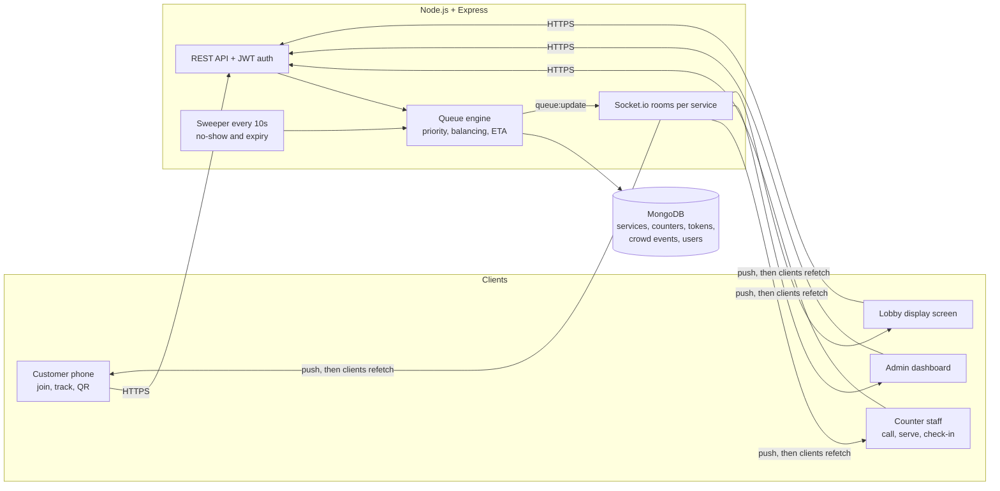
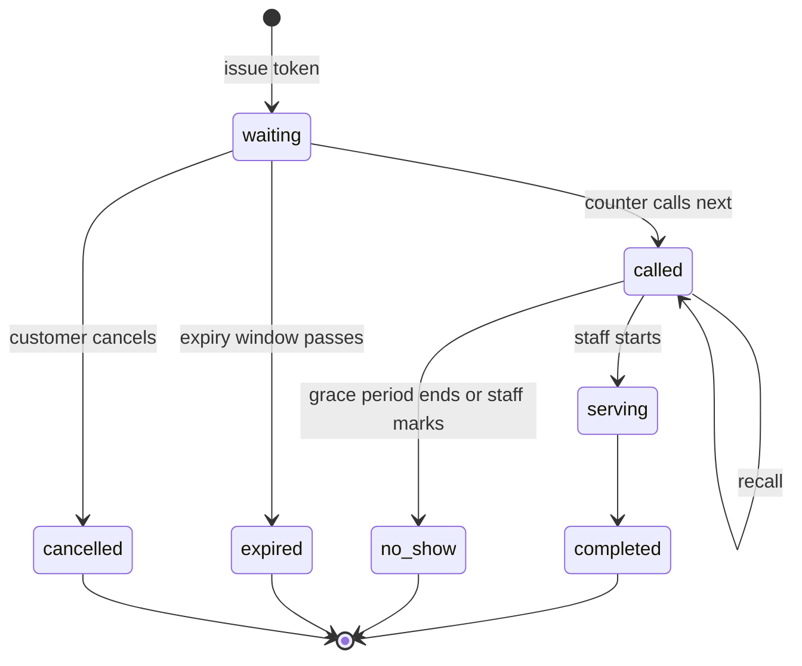

# QueueFlow: Universal Digital Queue & Crowd Management Platform

Join queues remotely, watch your place move live, and keep waiting rooms uncrowded.
Built with **React (Vite)**, **Node/Express**, **MongoDB (Mongoose)** and **Socket.io**.

## Features
| Feature | Where |
|---|---|
| Virtual tokens with QR code | `/join/:id`, `/track/:code` |
| Live position and wait time (blends configured and observed service time) | `queueEngine.js` |
| Multiple counters, automatic distribution, dynamic rebalancing | `rebalance()` |
| Priority queues: emergency (staff-issued), accessibility, senior | `QUEUE_SORT` |
| No-show detection and token expiry (background sweeper) | `sweep()` |
| Crowd density from check-in/check-out events | `/api/crowd`, Entrance desk |
| Public lobby display with chime and voice announcements | `/display/:id` |
| Staff counter desk, admin analytics, service/counter/staff management | `/staff`, `/admin` |

## Quick start
Requirements: Node 18+ and MongoDB (local, Docker, or Atlas).

```bash
docker compose up -d                 # optional: local MongoDB
npm run install:all
cp server/.env.example server/.env   # edit MONGODB_URI / JWT_SECRET if needed
npm run seed                         # demo data (resets the database)

# development (two terminals)
npm run dev:server                   # API on :5000
npm run dev:client                   # UI on http://localhost:5173

# or single-process production
npm run build && npm start           # http://localhost:5000
```

Demo logins (after seeding): `admin@queueflow.com / Admin@123`, `hospital@queueflow.com / Staff@123`,
`bank@queueflow.com / Staff@123`, `passport@queueflow.com / Staff@123`. Change them before deploying.

## Architecture


### Token lifecycle


## Design notes
- **Fair and race-safe**: a counter claims the best waiting token with one atomic `findOneAndUpdate`, so two counters can never take the same token.
- **Order**: emergency, then accessibility/senior, then standard; first come first served within each tier.
- **Balancing**: waiting tokens are spread over open counters (least loaded first) whenever a token is issued, a counter opens/closes, or a token finishes. Any free counter takes the global best token, so no counter idles while others have backlog.
- **Emergency priority** can only be issued by authenticated staff. Senior/accessibility are self-declared and should be verified at the counter.
- **Privacy**: public snapshots (lobby screen) expose token numbers only; names and phones are staff-only.
- **Crowd**: occupancy equals tokens currently checked in. Finishing, cancelling, expiring or no-show auto-checks the person out.
- **Time zone**: set `TIMEZONE` in `server/.env` (default `Asia/Kolkata`) for daily numbering and "today" stats.

## API overview
Public: `GET /api/services`, `GET /api/services/:id/snapshot`, `GET /api/services/:id/crowd`, `POST /api/tokens`,
`GET /api/tokens/:code`, `POST /api/tokens/:code/{cancel|check-in|check-out}`.
Staff: `/api/counters/:id/{call-next|start|complete|recall|no-show|status}`, `GET /api/services/:id/queue`, `POST /api/crowd/{check-in|check-out}`.
Admin: `/api/admin/{overview|users}`, service and counter CRUD.

## Ideas to extend
SMS/WhatsApp alerts when a token is near, camera QR scanning at the entrance, appointment slots, multilingual UI, per-counter skills (for example loans vs deposits).
